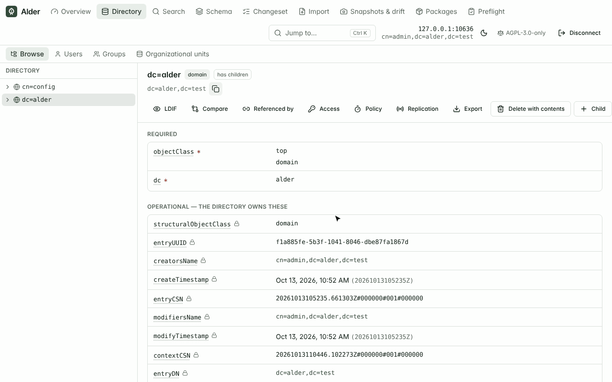

<p align="center">
  
</p>

<h1 align="center">Alder</h1>

<p align="center">
  <strong>A modern web UI and command line for OpenLDAP and 389 Directory Server.</strong><br>
  Browse the schema, edit entries safely, and get every change as LDIF or Ansible before it runs.
</p>

<p align="center">
  <a href="docs/GETTING-STARTED.md">Getting started</a> ·
  <a href="docs/FEATURES.md">Feature tour</a> ·
  <a href="docs/README.md">Documentation</a> ·
  <a href="https://github.com/Hazame-hub/alder/releases">Download</a>
</p>



> A directory engineering tool whose output is code.

If you own an LDAP directory, you probably manage it today with `ldapsearch`,
hand-written LDIF and an old admin tool nobody quite trusts. Alder replaces
that with one self-hosted binary: a browser interface for finding your way
around and making changes, and a command line for doing the same from CI.

Everything Alder does to a directory can be previewed as LDIF and exported as
an Ansible task. It is not a click-here-and-hope admin panel; it is an
authoring environment for directory changes, with a browser attached.

## Why Alder

- **Nothing is written without review.** Every change, from one attribute to a
  staged set of forty, is planned against the directory first and shown as the
  exact RFC 2849 change record that will be sent. If someone else changed the
  entry in the meantime, Alder refuses rather than overwrites.
- **Your changes become code.** Copy the LDIF, export an Ansible playbook, stage
  a changeset, or keep the directory's intended state in Git and let
  `alder project plan` tell CI whether production still matches.
- **It understands LDAP, not just strings.** The editor is built from the
  schema. DNs and filters are parsed, never pasted together. Nested groups are
  expanded with the chain that put each person there.
- **Two servers, one behaviour.** OpenLDAP and 389 DS are both first-class,
  enforced by one conformance suite that runs every case against both.
- **Safe to run.** Stateless, no database, TLS by default, credentials only
  in memory, passwords never sent to the browser. `--read-only` makes it a
  browser for production that cannot write.

## See it

<table>
  <tr>
    <td width="50%"><a href="docs/FEATURES.md#find-your-way-around-a-directory"></a><br><sub><b>Entries, annotated by the schema.</b> Required attributes marked, operational ones locked, secrets never shown.</sub></td>
    <td width="50%"><a href="docs/FEATURES.md#find-your-way-around-a-directory"></a><br><sub><b>Search that hands back its <code>ldapsearch</code>.</b> For a runbook, a ticket or a script.</sub></td>
  </tr>
  <tr>
    <td><a href="docs/FEATURES.md#find-your-way-around-a-directory"></a><br><sub><b>Who is really in a group.</b> Nested groups expanded, with the chain that reached each person.</sub></td>
    <td><a href="docs/FEATURES.md#change-it-safely"></a><br><sub><b>Changesets.</b> Stage several changes, check them against the directory, apply them in order.</sub></td>
  </tr>
  <tr>
    <td><a href="docs/FEATURES.md#change-it-safely"></a><br><sub><b>Every change as Ansible.</b> The same record, rendered as a <code>community.general</code> task.</sub></td>
    <td><a href="docs/FEATURES.md#the-schema-and-the-servers-own-configuration"></a><br><sub><b>A schema browser</b> that cross-links classes, attributes, syntaxes and rules, and edits them.</sub></td>
  </tr>
</table>

### And from a terminal

Keep a directory's intended state as LDIF in Git, validate it on every pull
request, and let a plan's exit code say whether a directory has drifted:


An entry the files do not mention is reported as unmanaged and never deleted.
See [`docs/PROJECT.md`](docs/PROJECT.md) and the working example in
[`examples/project/`](examples/project/).

## Quick start

Download the archive for your platform from the
[releases page](https://github.com/Hazame-hub/alder/releases) (Linux, macOS
and Windows, amd64 and arm64), or use the container image
`ghcr.io/hazame-hub/alder`. Then, on the machine you are sitting at:

```sh
alder serve --addr 127.0.0.1:8443 --allow-http
```

Open <http://127.0.0.1:8443>, enter your directory's host, port, bind DN and
password, and paste its CA certificate under *Certificate options* if it uses
a private CA. Add `--read-only` the first time you point it at a directory
that matters.

`--allow-http` is only safe because the address is the loopback. Anywhere
else, Alder serves HTTPS and refuses to start without a certificate; see
[Install](#install).

No directory to hand? [Getting started](docs/GETTING-STARTED.md) brings up a
seeded OpenLDAP and 389 DS in Docker and walks through a first change.

## What it does

| | |
|---|---|
| **Browse and search** | A lazy tree, entries annotated from the schema, a filter builder or raw RFC 4515 filters, ready-made people and group views, Ctrl+K to jump to any DN. |
| **Understand** | Who is in a group through nesting, what refers to an entry before you delete it, two entries compared attribute by attribute, what values an attribute actually holds across a subtree. |
| **Change safely** | A schema-driven editor; every write planned and shown as LDIF and Ansible; changesets applied in order; a plan saved for review and applied exactly, later; a recovery bundle for undoing what applied. |
| **Import and export** | LDIF in and out, an Ansible playbook that enforces state, filtered exports of what a search shows. |
| **Schema and configuration** | Browse and edit the schema, read and carefully edit the server's own configuration, read replication status and access rules. |
| **Drift and migration** | Snapshots of data, schema or configuration, compared with each other, with the live directory, or with a second, read-only server held beside it; portable change packages; a preflight before a migration; signed documents. |
| **Automate** | `alder snapshot`, `diff`, `plan`, `apply` and `project` run the same workflow from a shell or a CI job; a project in Git also opens in the browser. |

The [feature tour](docs/FEATURES.md) describes each of these, with
screenshots, and links to the reference for each.

## Install

Every release on the [releases page](https://github.com/Hazame-hub/alder/releases)
has an archive for Linux, macOS and Windows, on amd64 and arm64, with a
`checksums.txt` and an SBOM for each. The archive holds the binary, `alder`,
which is both the web interface (`alder serve`) and the command-line client.

```sh
version=1.41.0   # the release you want; x-release-please-version
archive="alder_${version}_linux_amd64.tar.gz"
curl -fsSLO "https://github.com/Hazame-hub/alder/releases/download/v${version}/${archive}"
curl -fsSLO "https://github.com/Hazame-hub/alder/releases/download/v${version}/checksums.txt"
grep " ${archive}\$" checksums.txt | sha256sum -c -
tar -xzf "$archive" alder && sudo install -m 0755 alder /usr/local/bin/alder
```

The container image is `ghcr.io/hazame-hub/alder`, tagged with each version
and `latest`, for linux/amd64 and linux/arm64. It starts `alder serve` and
listens on 8443. It runs as the distroless `nonroot` user (uid 65532), so the
certificate and key you mount must be readable by that user:

```sh
docker run --rm -p 8443:8443 -v "$PWD/tls:/certs:ro" \
  ghcr.io/hazame-hub/alder:latest serve --tls-cert /certs/tls.crt --tls-key /certs/tls.key
```

Alder refuses to start without TLS. It holds a directory bind password in memory
for the life of a browser session and will not carry it over a plaintext
connection by default; pass `--allow-http` only if something in front of it
terminates TLS, or the address is the loopback.

## Status

**Feature complete for v1**, and used against both target servers in CI on
every change. [`docs/COMPATIBILITY.md`](docs/COMPATIBILITY.md) says what 1.x
will and will not change under you: the LDIF and Ansible an export produces
are byte-stable, the HTTP API only grows, and the web interface is
deliberately not part of the promise. [`CHANGELOG.md`](CHANGELOG.md) lists
every release.

## Two servers, one behaviour

OpenLDAP and 389 Directory Server are both first-class, and that is enforced by
one table-driven conformance suite that runs every case against both:

```sh
task test:conformance:up
```

Nothing in Alder branches on the vendor. The RootDSE is read once at connect
time into a `Capabilities` value and behaviour follows from that. It is why the
same code finds the schema at `cn=Subschema` on OpenLDAP and `cn=schema` on
389 DS without knowing which is which.

## Security posture

- Bind credentials live in server memory keyed by an httpOnly, Secure,
  SameSite=Strict cookie. Not on disk, not in a JWT, not in `localStorage`.
  Restarting the server logs everyone out. What the browser keeps -- the last
  connection and the saved ones -- is hosts, DNs and CA certificates, never a
  password.
- Sensitive attributes (`userPassword` and friends) are never sent to the
  browser and never logged. The UI reports them as set, with a count.
- LDIF exports omit them too, unless explicitly asked for.
- `attr:< url` references in imported LDIF are refused. Following one from a
  process holding a privileged bind would be file disclosure via `file://` and
  request forgery via `http://`.
- Filters are parsed and re-escaped; DNs are parsed and re-rendered. Neither is
  ever built by string concatenation.
- TLS is on by default in both directions.
- `--allowed-targets` restricts which directories this instance may connect to,
  enforced on the server before anything is dialled. Unset, any target is
  permitted, which is right for a laptop beside the directory and wrong for
  anything other people can reach.
- `--read-only` refuses every write, whatever the directory would allow.
- `--max-in-flight` caps how many API requests are answered at once.
- `--max-sessions` caps how many directory sessions are held at once (256 by
  default). Reconnecting from a browser closes the session it replaces.
- Every flag also reads `ALDER_<FLAG_NAME>`.

Report a vulnerability as [`SECURITY.md`](SECURITY.md) describes.

## Documentation

[`docs/README.md`](docs/README.md) is the index. The places to start:

| | |
|---|---|
| [Getting started](docs/GETTING-STARTED.md) | Run Alder, connect, and make a first reviewed change |
| [Feature tour](docs/FEATURES.md) | Everything Alder does, with screenshots |
| [The command line](docs/CLI.md) | `snapshot`, `diff`, `plan`, `apply` and the rest |
| [Projects](docs/PROJECT.md) | A directory's intended state, kept in Git |
| [Compatibility](docs/COMPATIBILITY.md) | What 1.x promises |
| [Decisions](docs/DECISIONS.md) | Why it is built the way it is |

## Contributing

[`CONTRIBUTING.md`](CONTRIBUTING.md) has the setup, the rules that are not
style preferences, and a map of the code. [`CHARTER.md`](CHARTER.md) says what
Alder is and is not going to become.

```sh
task compose:up      # OpenLDAP and 389 DS, seeded, with TLS
task check           # vet, lint, type-check, test: what CI runs
task test:conformance
```

## Licence

[GNU Affero General Public License v3.0](LICENSE).

The AGPL is deliberate rather than incidental. Alder is a tool you run as a
service, and section 13 is the clause that matters: if you modify Alder and let
other people use it over a network, you have to offer them your modified
source. That keeps the conformance harness — the expensive part, and the thing
that makes "works on both servers" true rather than aspirational — from being
absorbed into something closed.

Using Alder to administer your directory imposes nothing on you. Your
directory's data is yours, the LDIF and Ansible it generates are yours, and
running it internally is not distribution. The obligation attaches only if you
modify Alder itself and offer that modified version to others.

Alder serves its own source offer at `/api/v1/source`, which is what section 13
asks for. If you deploy a modified build, point `--source-url` at your fork.

Contributions are covered by a [Contributor Licence Agreement](CLA.md), which
keeps the option of licensing Alder on other terms open. Contributors keep the
copyright in their work.

The name and logo are not covered by the AGPL: a modified version or a fork
takes its own name. [TRADEMARKS.md](TRADEMARKS.md) says what you may do with
them.

*Alder wood hardens instead of rotting when submerged. Venice stands on alder
piles that have held for centuries. It seemed a fitting name for the directory
everything else authenticates against.*
