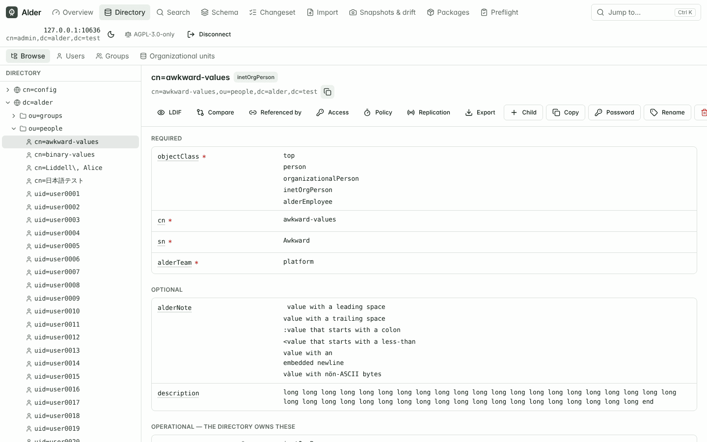
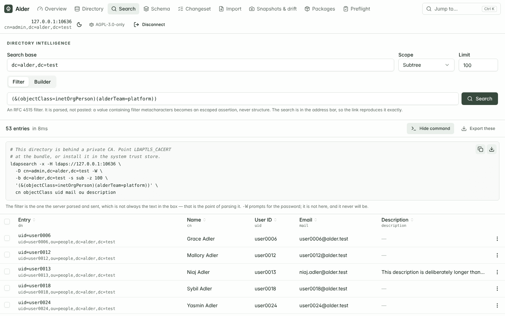
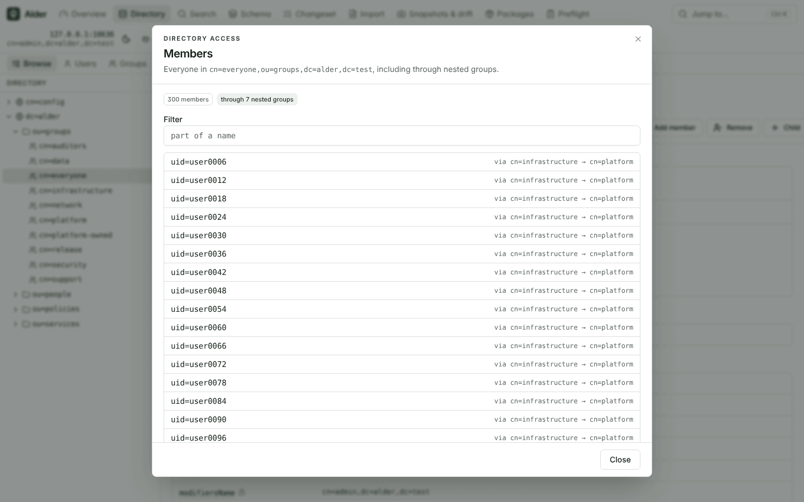
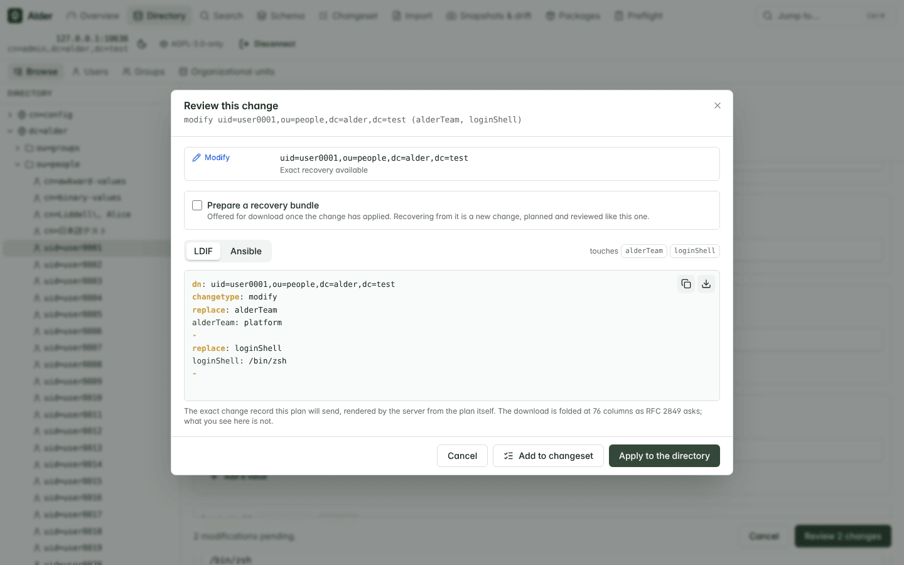
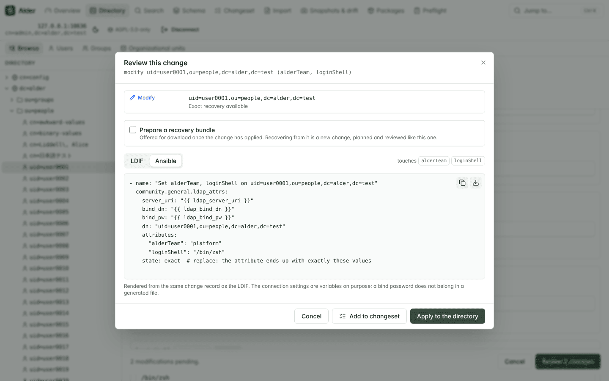
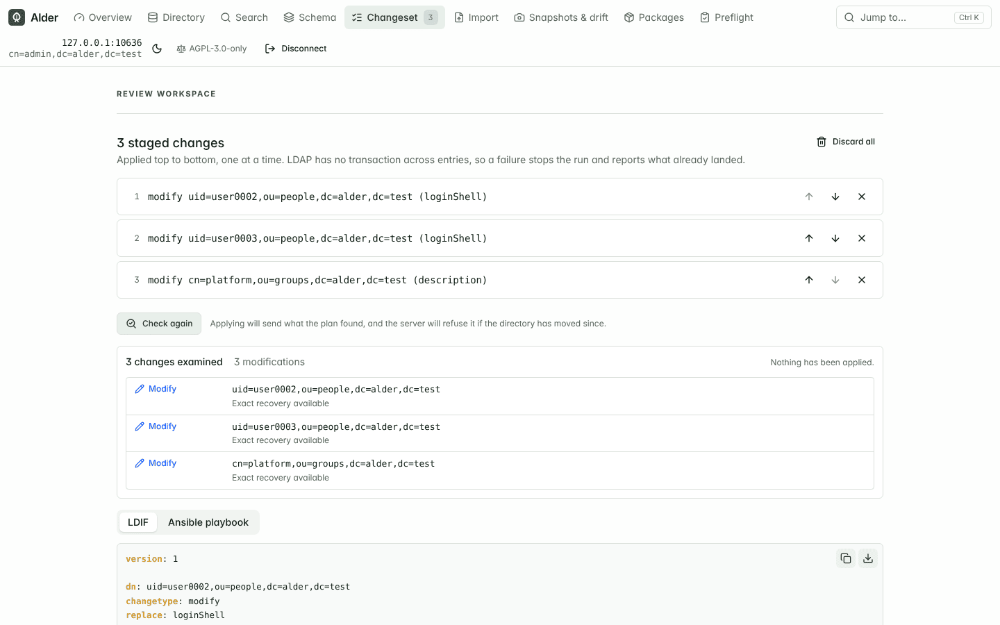
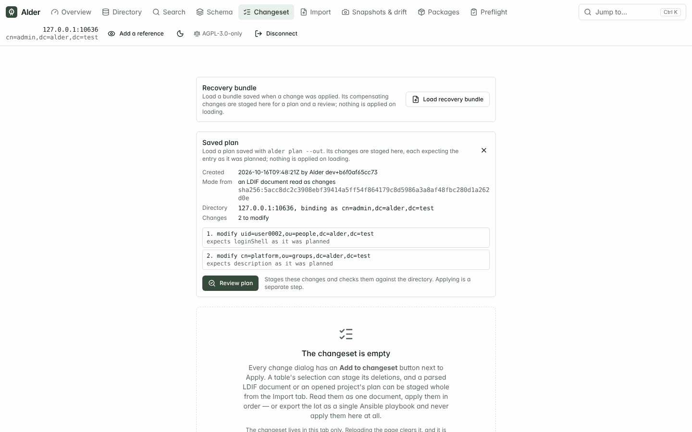
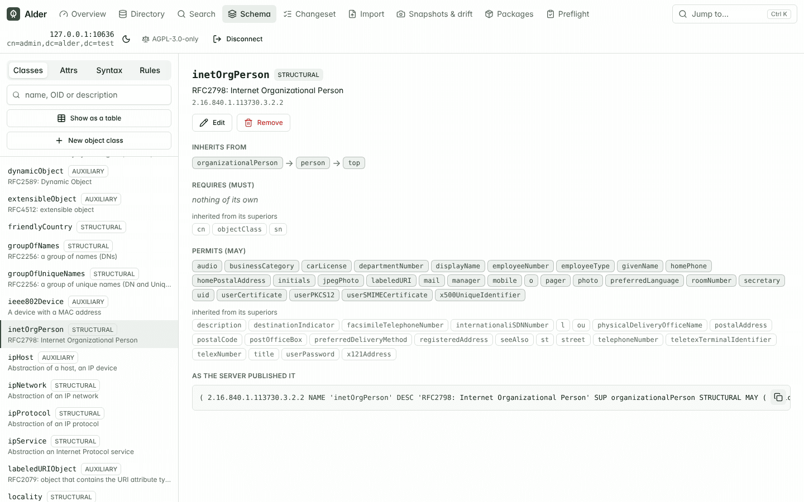
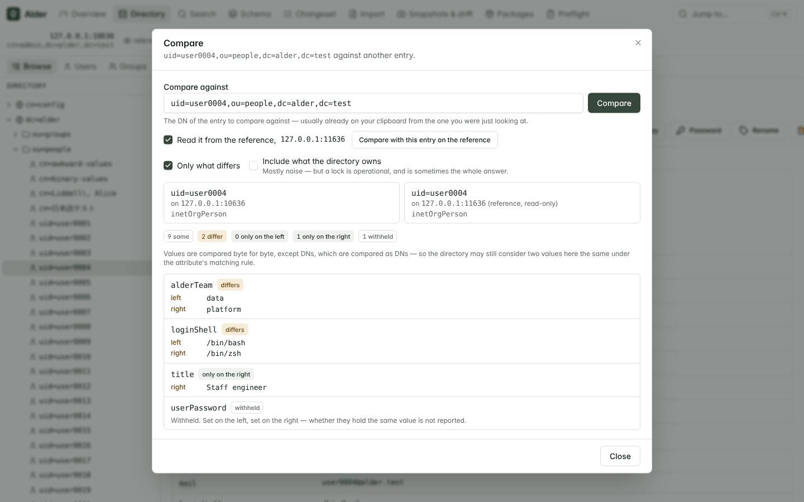
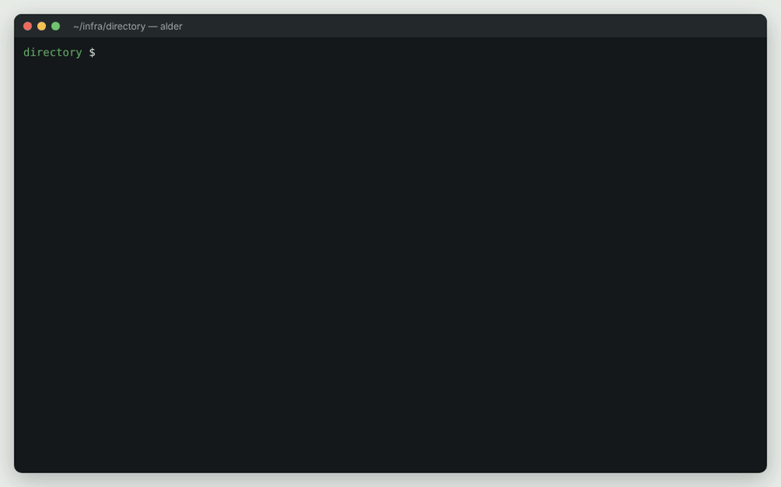

# What Alder does

A tour of every feature, grouped by the job you are doing. If you have not
used Alder yet, start with [Getting started](GETTING-STARTED.md): it takes
you from nothing to a first reviewed change in a few minutes. The reference
pages for each area are linked from its section.

All screenshots are of a real Alder build against the test harness's
OpenLDAP directory.

- [Find your way around a directory](#find-your-way-around-a-directory)
- [Change it safely](#change-it-safely)
- [Import and export](#import-and-export)
- [The schema and the server's own configuration](#the-schema-and-the-servers-own-configuration)
- [Drift, snapshots and migrations](#drift-snapshots-and-migrations)
- [Automate it: the command line and Git](#automate-it-the-command-line-and-git)

## Find your way around a directory

**Browse** the DIT as a lazy tree, one level per expansion. Entries render with
their attributes annotated from the schema: required attributes marked, the
directory's own operational attributes filed separately and read-only, DN values
as links, timestamps as dates, binary values as sizes rather than mojibake.

<picture>
  <source media="(prefers-color-scheme: dark)" srcset="screenshots/entry-viewer-dark.png">
  
</picture>

*An entry from the test harness, chosen because every one of its values is
awkward: a leading space, a trailing space, one starting with a colon, one with
an embedded newline, one with non-ASCII bytes. Required attributes are marked,
the directory's own operational attributes are filed separately and locked.*

**Search** with a filter builder or a raw RFC 4515 filter. Filters are parsed,
never interpolated. Every search is paged and bounded, and a truncated result
says so.

Every search hands back the `ldapsearch` that runs it, for a runbook, a ticket
or a script. The server renders it, so the filter in it is the one the server
parsed and sent rather than the text in the box — normalising it is the whole
point of parsing it, and a command built from what was typed would describe a
different search from the results beside it. It reproduces what the session
actually did, down to `-ZZ` for StartTLS and an `LDAPTLS_REQCERT=never` where
verification was skipped. The password is not in it: `-W` prompts.

Searching for people and groups is most of what anyone does, so those are ready
made: tabs that run the filter for you and show the columns that matter for what
you asked about. The columns are yours to choose, from what the schema says the
matching entries can actually hold rather than from a fixed list — a directory's
own attributes are the interesting ones, and a fixed list never has them.
Choosing a column re-runs the search asking for it, because a column added to
rows already fetched shows a dash that reads as "there is no value" when it
means "nobody asked for one".

<picture>
  <source media="(prefers-color-scheme: dark)" srcset="screenshots/search-dark.png">
  
</picture>

**Jump to anything from the keyboard.** Ctrl+K takes a DN and opens it, an RFC
4515 filter and runs it, or a name and looks for it. The server does the
parsing, because `internal/dn` and `internal/filter` are the authorities on what
those strings are and a pattern in the browser would drift from them. It never
guesses: `cn=platform` is a valid one-component DN *and* almost certainly a
request to find something called platform, so both are offered and you pick.

**Switch between directories by name.** The connection screen remembers the
last connection that worked and keeps a list of connections saved under names
-- primary, replica, dev, prod -- to fill the form with one pick, rename or
delete. Both live in this browser's `localStorage`, up to 25 saved, and hold
everything except the passwords, which are typed every time.

**See who is in a group,** which is the same question from the other side and a
harder one than it looks. A member list answers it only while no member is
itself a group: `cn=everyone` in the test harness lists five members and
contains no people at all, because every one of the five is a group — and three
hundred people are in it. Expanding walks that structure and says, for each
person, the chain of groups that reached them, which is what you need in order
to remove somebody from the right group rather than the outermost one. A group
that contains itself, a member DN the directory says there is no such entry for
(deleted, or not visible to this bind: the answer is the same), a member that
could not be read at all, and a `memberUid` that holds a login name rather than
a DN are each reported rather than dropped, and each as what it is.

*`cn=everyone` lists five members and contains no people directly. Expanded, it
holds 300, each with the chain of groups that reached them.*

**See what names an entry** before you break it. Which groups is this account in,
what else points at it — the question asked most often about an account, and the
one to ask before deleting anything. The answer says which attribute each
referring entry uses, not merely that it refers, because they are not the same
thing to undo: one entry can hold the same person as a `member` and as an
`owner`, and removing either is a delete of one value of that one attribute on
the entry doing the naming. So each is offered separately, and each goes through
the usual preview.

The values are compared as the directory would compare them. A server may return
a reference spelled differently from the entry's own DN, and `uniqueMember`
carries an optional UID suffix that is not part of the DN at all; a reference
missed for either reason is a reference nobody is warned about.

**Compare two entries** when one account works and another does not. Attribute
by attribute: what they share, what differs, what only one has. Each side is
annotated from its *own* object classes, which the two entries need not share —
so an attribute one entry's classes require and it does not hold shows up, and
that absence is often the whole answer while being invisible to any diff of
what is present. DNs are compared as DNs. Sensitive attributes are compared on
presence alone: that a password is set is not a secret, but whether two entries
hold the same one is not a question this answers.

**Tally what an attribute actually holds** across a subtree — the query that
finds a team name spelled wrong with four people on it, a cost centre nobody
has used since a reorganisation, or the accounts still pointing at a
decommissioned site. It is a tally over a bounded search, so every number is
scoped to the entries examined and says so; a tally that quietly summarises a
truncated result set is not a weaker answer than the truth, it is a confident
wrong one. Values held by exactly one entry are called out, because that is
usually where the typo is. Sensitive attributes are refused before the search
runs rather than filtered out of the result.

## Change it safely

**Edit** through a form the schema builds. Single-valued attributes get no "add
value" button. `NO-USER-MODIFICATION` attributes are not editable. "Add an
attribute" offers exactly what the entry's object classes permit, and nothing
else. An attribute whose values are binary is shown but not editable as text.

**Confirm** every write. There is one code path that modifies a directory and it
opens this dialog first, showing the exact RFC 2849 change record that will be
sent — rendered by the server from the same `ChangeRecord` it will act on, so
the preview and the effect cannot drift apart. The same record renders as a
`community.general` Ansible task on the next tab.

If someone else changes the entry while you have it open, the editor says which
attributes drifted and that applying will overwrite them, rather than silently
discarding your work or silently clobbering theirs.

<picture>
  <source media="(prefers-color-scheme: dark)" srcset="screenshots/ldif-preview-dark.png">
  
</picture>

The **Ansible** tab renders the same change as a `community.general` task:

**One change goes through the same plan as a thousand.** Editing an entry,
creating, renaming, moving or deleting one, setting a password, changing a group,
adding a schema definition or a configuration setting: the confirmation dialog
plans the change against the directory, shows what it does and what it touches
beside the exact LDIF, and applies what was reviewed with the plan's token. If
somebody else changed the entry in the meantime nothing is written, and the
dialog asks you to recompute the plan and look again. A change that would do
nothing says so and offers nothing to apply.

**Stage a changeset.** Every confirmation dialog can queue its change instead of
applying it. A staged set is read as one LDIF document and exported as one
Ansible playbook, reordered by hand, and applied in order. Alder points out what
no single change can see — an entry created before its parent, an entry acted on
after being deleted, the same entry changed twice — and reorders nothing on its
own, because a move under something created later is a legitimate thing to want.

A run stops at the first refusal and reports what landed and what was not
attempted; LDAP has no transaction across entries, so nothing is rolled back and
Alder does not pretend otherwise. What did not apply stays staged, in order, so
correcting one change and applying again resumes rather than repeats.

**Check a changeset against the directory before applying it.** Staging twenty
changes and applying them is a different act from staging twenty changes,
walking away, and applying them an hour later — by which time somebody else has
edited two of the entries. `POST /api/v1/plan` reads every entry the set names
and reports what each change would actually do: an addition, a modification, a
rename, a deletion, nothing at all because the entry already holds what you are
setting, or a conflict the directory would refuse. Nothing is written.

The classification is a stable identifier a script can switch on, and the plan
hands back the records themselves rather than a description of them — so what
you were shown is the value that runs, not an equivalent one reconstructed
later. A reconciled change is where that matters: what you sent was an add and
what runs is a modification of the one attribute that differs, and the plan
shows the second.

Each planned change carries a fingerprint of the state it was planned against.
Send it back when applying and the server re-reads the entry and refuses the
whole set if anything it depended on has moved. It is a keyed hash rather than
a snapshot and holds no attribute values; a password being set is bound by a
session-keyed MAC, so a different password is refused without the token ever
revealing anything about either. Applying without one behaves exactly as it did
before.

**Plan an LDIF document, and say how to read it.** The plan takes an LDIF
document as well as staged changes, read one of two ways and never guessed. As
`changes`, every record is the exact operation it states, and an add of an entry
that already exists is a conflict rather than a modification nobody asked for.
As `desired` state, a record says what an entry should hold, the plan works out
the modification that gets it there, and an entry the document does not mention
is left alone: absence never means deletion. A desired-state document that also
contains `changetype` records is refused, with the records named.

A plan reports impact as facts, not a score: whether each change touches data,
the schema or the server's own configuration; the group memberships it adds and
removes; for a deletion or a rename, the entries that still name the DN and how
many the plan would leave dangling; and deletions grouped into the subtrees they
remove. What you reviewed is what runs — applying refuses a change that is not
the operation its plan was issued for, refuses a plan the directory has moved
away from, names every change affected either way, and never replans on your
behalf. Passwords are withheld from plans, previews and apply responses alike.
[PLAN.md](PLAN.md) is the reference.

**Delete a container** by staging what is under it. LDAP deletes one leaf at a
time, so removing an organisational unit means removing everything below it
first, deepest first, in order. Alder walks the subtree, stages the deletions in
that order, and hands you the list to review as one changeset — rather than
refusing because the entry has children, which is what it used to do while
offering no way to do the thing it was suggesting.

**Make one modification over the entries you selected.** On the search results
and the object views, *Edit an attribute…* beside *Stage deletions* takes one
attribute, one operation (add a value, remove a value, remove the attribute, or
replace with) and the same value for every selected entry, and stages one
`modify` per entry. Only the attributes every selected entry's classes permit
are offered, unless you widen the list; passwords, attributes the server owns
and `objectClass` never are. A membership attribute takes add or remove only,
one member picked from the directory, and an entry named by the attribute is
left out of a removal and named. The plan then says which entries already
match, which are gone and which do not permit the attribute, and sends nothing
for those. The set of entries is fixed when it is staged: nothing re-runs the
search. [proposals/bulk-attribute-edit.md](proposals/bulk-attribute-edit.md)
is the design.

**Prepare a recovery before you apply.** A plan says how recoverable each change
is -- exact, partial or unavailable -- and why. Exact is about the ordinary
directory data the change touches, not timestamps, server-generated identifiers
or replication metadata. Ask for a recovery bundle and,
once the change has applied, Alder hands you a versioned JSON document: the
compensating changes it could derive from each entry as it was immediately
before the change, only for what actually applied, to run in reverse order. It
holds no password and Alder keeps no copy. It is not a rollback or a backup.
Loading it turns it into ordinary changes that go through the same plan and
review, each carrying the state its entry must still be in, so a compensation
whose entry has changed since is a conflict and never an overwrite. From a
shell, `alder apply --recovery-out` writes one and `--recovery` plans one.
Details in [`RECOVERY.md`](RECOVERY.md).

**Save a plan, and apply exactly it later.** A review and an apply are not
always the same moment: a plan goes into a ticket, someone approves it, and the
apply runs tomorrow. `alder plan --out` saves the plan of an LDIF document or of
`--changes` as a file, and `alder apply --plan` applies that file and nothing
else. Each change in it is the plan's own record, carrying what the entry held
when it was planned: the values a modification replaces, and for a deletion the
whole entry. So the file still works after the Alder that made it restarts, and
through any other Alder; a plan made for another host or bind is refused before
anything connects, and if any change no longer holds because the directory
moved, the whole file is refused and nothing is written. A rename or a password
change is not saved; apply those directly.

In the browser, **Load saved plan** sits beside *Load recovery bundle* on the
empty changeset. It shows when the plan was made and from what, the directory
and bind it was made for, and what each change expects; nothing is applied on
loading. *Review plan* stages the changes and checks them against the
directory, and the set is applied whole or not at all, as `alder apply --plan`
applies it. A plan made for another directory or login is refused there too,
and a project's plan is left to `alder project apply --plan`. See
[CLI.md](CLI.md#a-saved-plan).

## Import and export

**Import and export.** Export an entry, a subtree, or what a search is
showing — the table's filter goes to the exporter, because "the thirty people I
just searched for" is the thing that actually goes in a ticket, and it used to be
assembled by hand. The entries come out whole rather than cut down to the
displayed columns: a partial entry is not something you can put back. A filtered
export says so in the file's header, since a file that does not describes
something narrower than its base and reads later as the whole of it.

The same thing exports as an Ansible playbook that *enforces* it rather than one
that merely creates what is missing. `ldap_entry` with `state: present` asserts
an entry exists and stops there — run it against an entry holding entirely
different attributes and it reports success and changes nothing — so each entry
gets a create task and an `ldap_attrs` task with `state: exact`, ordered parent
first because nothing can create a child under a parent that does not exist yet.
Attributes the directory owns are left out, since a task enforcing one fails on
every run, and sensitive ones are left out with no way to include them: a
playbook is a file destined for a repository.

Import a document and apply its records one at a time, each through the same
confirmation, or stage the whole parsed document into the changeset and review it
as one thing. A file of forty records is a decision about forty records, and
confirming them one by one is not the same review.

That closes the loop the export half opens: export a subtree, correct what is
wrong in the file, import it back. An exported record has no `changetype`, so it
is an add, and a directory refuses an add for an entry that exists — so import
can be told to update entries that are already there, turning such a record into
a modification instead.

It replaces the attributes the record names and leaves every other attribute
exactly as it is. An export omits `userPassword` always and operational
attributes by default, and a file that does not mention an attribute is not a
file asking for it to be removed. A document that has not been edited produces
no changes at all rather than a page of modifications that do nothing, and the
entries that already match are listed so you can see the import understood them.

An export can also be drawn as an **outline** — the same entries as the tree they
form, with what each one is and how much sits below it. It is deliberately not
LDIF and says so on its first line: LDIF reads a leading space as a continuation
of the line above, so a tree drawn with indentation could never also be a
document you import. It is for reading, and for pasting into a ticket.

Or as **YAML**: the same tree with the values in it, nested so an editor folds a
subtree to one line and colours what is inside. Every attribute is a list even
where the schema says one value, so a second value never appears in a diff as a
change of type. Nothing reads it back — LDIF is the format with a specification
and a changetype — so it is for looking at, and it says so at the top.

## The schema and the server's own configuration

**Browse the schema** — object classes, attribute types, syntaxes and matching
rules, fully cross-linked. A class shows what it requires and permits, split
between its own and its inherited attributes, and every one is a link. An
attribute shows the classes that require and permit it, its syntax, and the
definition exactly as the server published it. Definitions the parser could not
read are listed rather than hidden.

**Edit the schema.** Object classes and attribute types can be added, changed
and removed, through a form or by writing an RFC 4512 definition out by hand —
either way it is parsed and checked before anything is sent.

A schema definition is a value of an attribute on an ordinary entry, so a schema
change is an ordinary modify, and it goes through the same confirmation, the
same LDIF preview, the same Ansible export and the same changeset as every other
write. There is still exactly one code path that writes to a directory.

Where the schema is kept differs, and Alder reads that from the server rather
than from its name. A server that announces a configuration tree generates its
subschema subentry from configuration entries, so a definition is written to one
of those — and Alder asks which, because they load in order and the first is the
server's core schema. A server that announces none has a subschema subentry that
is the schema, and takes the change directly.

The value a change removes is read back from the entry that holds it, never from
what the schema browser displays. The two differ: a server keeping its schema in
configuration prefixes each stored definition with its load order and strips
that prefix from what it publishes, and 389 DS records `X-ORIGIN 'user defined'`
on anything added at runtime. A change built from the displayed form would match
nothing on a removal and leave two definitions of one OID on an edit.

**Browse the server's own configuration.** A directory keeps its configuration
in the directory, and that tree appears in the browser beside the data whenever
the session can read it — the databases, the access rules, the schema. The DN is
taken from what the server announces, and otherwise found by trying the
conventional location and believing only what the server answers.

The account that administers a suffix usually has no rights in the
configuration, so the connection screen takes an optional second identity for
it. Requests are routed by DN: one session browses people as the directory
administrator and the configuration as the configuration administrator, and
neither borrows the other's rights. Without it, reaching the configuration would
mean connecting as the configuration administrator and giving up the data.

**Edit the configuration, carefully.** Configuration entries are ordinary
entries, so the same editor and the same LDIF preview work on them. Changing
them is not ordinary, so a change addressed into the configuration tree says so,
and a change touching something you can lock yourself out with — access rules,
the administrative identity, the ports the server listens on — says which and
why. Nothing blocks; the directory decides, and you are the one who asked.

Where a server keeps its schema in the subschema subentry rather than in
configuration entries, that entry is a root of its own. It sits outside every
naming context, so it appears under nothing else — which made it the one part of
such a directory the tree could not reach.

**See what this server says about its own replication.** Whether it supplies,
consumes or both; which links it has and to whom; and, the part that actually
answers "is it working", how far along it is -- the most recent change it
holds from each origin, and when that change was made. OpenLDAP writes that as
`contextCSN` on the suffix and 389 DS as a replica update vector on a replica
entry; Alder reads both into the same pair, so opening the card against two
servers and comparing is how drift becomes visible.

Alder does not contact the other servers. A report that dialled out to
whatever host a configuration value happened to name would be a report that
can be pointed at anything, so everything here is what *this* server has
written down -- including the fact that OpenLDAP records no status for a
syncrepl link at all, which is said rather than left as an empty column.
Credentials are never read: the password inside an `olcSyncrepl` value is
dropped as the value is parsed. Details in
[`REPLICATION.md`](REPLICATION.md).

## Drift, snapshots and migrations

**Snapshot a subtree, and compare it later.** A snapshot is a versioned JSON
document you download and keep: canonical, so the same state produces the same
file; checksummed; and holding no password, only a count of how many there were.
Compare it with another snapshot or with the directory as it is now. Every
difference is `added`, `removed`, `modified`, `renamed` (only when the entry's
`entryUUID` or `nsUniqueId` proves it) or `unknown`, and a comparison that could
not see everything says so rather than calling what it missed deleted. Values
compare by the attribute's matching rule, so a DN spelled differently is not a
change. When the directory is the source, pick the differences to undo and stage
them: they go through the same plan and review as every other write. Deleting an
entry is never selected for you. Details in
[`SNAPSHOTS.md`](SNAPSHOTS.md).

**Snapshot and compare the schema.** The same capture, with `kind: schema`,
records the schema a server publishes as a deterministic, checksummed document.
Definitions are identified by OID and compared by meaning: the order of NAMEs,
quoting, or a reference written by name rather than OID make no difference; a
changed `SYNTAX`, `MUST` or `SINGLE-VALUE` does. A difference only in `X-`
extensions is reported as metadata and never proposed. With the live schema as
the source, the additions, modifications and removals you select become ordinary
schema changes, in dependency order, through the same plan. A removal is never
selected for you, and a change that needs another is refused until you select
that one too. It works on OpenLDAP and 389 DS, and between them. Details in
[`SCHEMA-SNAPSHOTS.md`](SCHEMA-SNAPSHOTS.md).

**Snapshot and compare the configuration.** The same capture, with
`kind: config`, records a server's own configuration -- its settings, and the
databases, overlays, backends and plugins they belong to -- as a deterministic,
checksummed document. Settings are identified by what the server names them,
never by their position in a list, so renumbering a database changes nothing.
Secrets are recorded as present and counted, never as a value and never as a
digest of one; runtime counters are not configuration and are left out. Compare
two captures, or one and the live server, and see what changed and which
settings Alder can actually change -- those go through the same plan and review
as every other write, and nothing else is ever staged. Configuration belongs to
the server's software: given two different products, Alder says so and compares
nothing, rather than producing a thousand differences that are artefacts of the
comparison. Alder also reads the access control rules a server holds and shows
which of them bear on an entry -- `aci` attributes up the tree, `olcAccess` in
the configuration tree -- in the server's own order and its own words; it never
writes them and never claims to evaluate them. Where a server answers the real
question itself -- 389 Directory Server publishes the Get Effective Rights
control -- Alder asks it, and shows the directory's own verdict above the
rules. A comparison also lists the
configuration objects each side has --
databases, overlays, backends, plugins -- and Alder creates and removes two
kinds of them: an OpenLDAP overlay whose module the server has already loaded,
and an index, on either server. An index is one intention and two entirely
different writes -- a value on the database entry on OpenLDAP, an entry of its
own beneath the backend on 389 DS -- so a comparison reports both as the same
kind of object, named by the backend and the attribute, and derives each
server's own change from that.
Every setting Alder offers to change is one the test suite has
written, read back and restored on both servers. A configuration snapshot can
also be preflighted against another server of the same software, to see what
would have to change for it to match. Details in
[`CONFIG-SNAPSHOTS.md`](CONFIG-SNAPSHOTS.md).

**Compare two servers without leaving either.** A session can hold a second
server, the *reference* -- a replica beside its primary, staging beside
production -- attached from the header and held read-only: nothing in Alder can
write to it. Capture it, compare it with the server you are connected to (data,
schema or configuration, with changes proposed only for your own server),
compare one entry on both, and read its replication beside yours. Its password
is held in memory for the life of the session, like yours, and is discarded when
it is detached or the session ends. Every write dialog says which server it
applies to. Details in
[`proposals/second-server.md`](proposals/second-server.md).

*`uid=user0004` on the directory Alder is connected to, compared with the same
entry on a reference server where someone changed its team and shell and gave
it a title. The password is compared on presence alone.*

**Carry a change between directories.** A change package is a portable
description of what you intend to change -- entries and schema together, with
the dependencies between them written down. It holds no password, no plan token
and no trace of where one server keeps its schema, so the same file works on
OpenLDAP and on 389 Directory Server. Take it to the next directory and Alder
asks that directory what the intent means there: what is ready, what it already
satisfies, what conflicts with what is there now, what is missing. The changes
that are ready are staged, planned against that directory and reviewed like
every other change. Promotion is revalidation, not replay: test accepting a
package says nothing about production, and nothing is overwritten because
another environment agreed. Details in
[`CHANGE-PACKAGES.md`](CHANGE-PACKAGES.md).

**Preflight a migration before anything moves.** Give Alder a change package, a
schema snapshot or a data snapshot -- made on this directory or another one --
and it reports what would carry across to the directory you are connected to,
finding by finding: what is already there, what could be added, what needs
something done first, what contradicts it, what the server cannot represent,
and what this bind could not see. It checks definitions by OID and meaning,
syntaxes and matching rules the target publishes, naming contexts, parents,
MUST and SINGLE-VALUE rules, and what DN-valued attributes name, and it explains
why one thing cannot carry across because another cannot. It is analysis only:
nothing is written, nothing in the artifact is changed, no DN is rewritten and
no attribute is mapped, and a vendor difference alone decides nothing. Access
control and server configuration are reported as not evaluated. `alder
preflight` gives a pipeline an exit code to stop a promotion on. Details in
[`PREFLIGHT.md`](PREFLIGHT.md).

**Sign what you hand over, and check what you are handed.** A checksum shows a
file was not corrupted; it cannot show who made it. `alder key generate` makes
an Ed25519 key pair, `alder sign` wraps a snapshot, package or recovery bundle
in a signed envelope, and `alder verify` checks one against the public keys you
name -- all three on your own machine, with no server and no directory, and the
private key never reaches Alder. A server started with `--trusted-keys` says,
wherever it reads a document, whether it was signed and by whom; a document
changed after signing is refused before anything reads it, and
`--require-signature` makes signed documents the only ones it reads. Details in
[`SIGNING.md`](SIGNING.md).

## Automate it: the command line and Git

**Do it from a shell.** `alder snapshot`, `alder diff`, `alder plan` and
`alder apply` run the same workflow from a terminal or a CI job, through a
running Alder server: the same snapshot file, the same comparison, the same
plan, and an apply that sends exactly the plan it showed and refuses if the
directory moved in between. `--json` is the API's own response, exit codes say
whether a comparison found differences or could not see everything, and a
password is never a command-line argument. The client has no LDAP code of its
own. It uses the server's Snapshot, Diff, Plan and Apply, and adds its own
safety policy on top: it asks before applying, needs `--allow-deletes` before
`--yes` will delete, and refuses a plan that already contains a conflict. Two
snapshot files are compared without any directory credentials. `alder plan
--out` saves a plan for `alder apply --plan` to apply exactly, later, in
another job. See [`CLI.md`](CLI.md).

**Keep a directory's intended state in Git.** An Alder project is an
`alder.yaml` beside LDIF files in a repository: the subtrees the repository is
responsible for, and the environments it is planned against. `alder project
validate` checks it offline, in a pre-commit hook or on every pull request,
and refuses a file that carries a password. `alder project plan --env prod
--detailed-exitcode` answers "does production match the repository?" with an
exit status, and `alder project apply` plans again against the directory as it
is, shows that plan, asks, and applies it. Where an approval sits between
plan and apply, `project plan --out` saves the plan and `project apply --plan`
applies exactly that file, through any Alder, or refuses it whole if the
directory has moved. There is no state file, and an entry the files do not
mention is never deleted: the plan lists it as unmanaged.
`alder project fmt` keeps the LDIF in one canonical form so a diff shows what
changed. See [`PROJECT.md`](PROJECT.md), and
[`examples/project/`](../examples/project/) for a project with its CI: validate
on every pull request, a scheduled plan for drift, and an optional apply that
saves the plan in one job and applies that file in a second, only once someone
approves it.

**Open a project in the browser.** *Open project*, on the Import screen,
takes the folder holding `alder.yaml` -- chosen, dropped on the panel, or
as a `.zip` -- and plans it against the directory the
session is connected to: the same validation as `alder project validate`,
with every problem listed by file and line, then the plan and the unmanaged
entries, under a heading that names the project and the directory it was
planned against. The environments in `alder.yaml` are not used here; the
plan is always the session's. *Stage for review* puts the plan into an
empty changeset, where it is checked again, applied with baselines and can
be exported as LDIF or an Ansible playbook. Only `alder.yaml` and the
`*.ldif` files are read from the folder (a repository whose `alder.yaml`
is one folder down opens that folder; with several, you pick), nothing is
stored, and a project
too large for one request (16 MiB, 1,000 files, a 2,000-change changeset)
is said to be one for `alder project`.

*A real session: validate a project offline, apply it to a directory after
reviewing the plan, change one line in Git, and let `--detailed-exitcode` say
the directory no longer matches. An entry nobody described is reported as
unmanaged, never deleted.*
