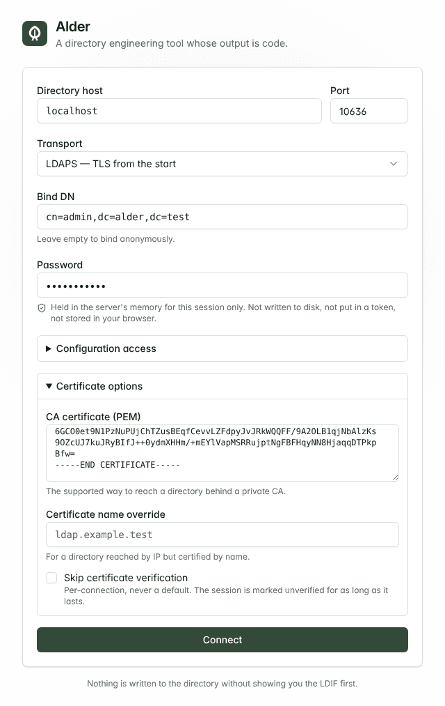

# Getting started

This guide takes you from nothing to a first reviewed change, then shows the
same workflow from a terminal. It takes about ten minutes. You need no LDAP
directory of your own: step 1 gives you two to practise on.

If you already know what you are looking for, the [feature tour](FEATURES.md)
covers everything Alder does and the [documentation index](README.md) lists
every reference page.

- [What Alder is, in one minute](#what-alder-is-in-one-minute)
- [1. Start a directory to practise on](#1-start-a-directory-to-practise-on)
- [2. Start Alder](#2-start-alder)
- [3. Connect](#3-connect)
- [4. Look around](#4-look-around)
- [5. Make your first change](#5-make-your-first-change)
- [6. Stage several changes and review them together](#6-stage-several-changes-and-review-them-together)
- [7. Catch drift with a snapshot](#7-catch-drift-with-a-snapshot)
- [8. Do it from a terminal](#8-do-it-from-a-terminal)
- [9. Point it at your own directory](#9-point-it-at-your-own-directory)

## What Alder is, in one minute

Alder is one binary, `alder`. `alder serve` runs a web interface for an LDAP
directory (OpenLDAP or 389 Directory Server); the other commands are a
command-line client of that same server.

Three ideas run through all of it:

- **Every write is a change record you see first.** Alder never sends a
  modification you have not been shown as the exact LDIF it will send. The
  same record exports as an Ansible task.
- **Every write is planned against the directory.** Before anything is
  applied, Alder reads the entries a change names and tells you what it will
  actually do. If the directory moves between the plan and the apply, the
  apply is refused.
- **Alder keeps nothing.** No database, no state on disk. Credentials live in
  the server's memory for the length of a session. Snapshots, packages and
  plans are files you download and keep.

## 1. Start a directory to practise on

The repository carries the test harness the conformance suite runs against:
OpenLDAP and 389 Directory Server, each seeded with the same 320 entries
under `dc=alder,dc=test` (300 people, ten groups, a few deliberately awkward
entries), with TLS from a test CA. You need Docker and
[Task](https://taskfile.dev).

```sh
git clone https://github.com/Hazame-hub/alder.git
cd alder
task compose:up
```

| | OpenLDAP | 389 DS |
|---|---|---|
| Address | `localhost:10636` (LDAPS) | `localhost:11636` (LDAPS) |
| Bind DN | `cn=admin,dc=alder,dc=test` | `cn=Directory Manager` |
| Password | `alder-admin` | `alder-directory-manager` |
| CA certificate | `test/compose/certs/ca.crt` | the same file |

[`test/compose/README.md`](../test/compose/README.md) has the rest: the
replicas, the configuration identities, and how to reset it.

## 2. Start Alder

Either build it from the checkout (Go 1.27.3 or newer and Node 22 or newer):

```sh
task build
./bin/alder serve --addr 127.0.0.1:8443 --allow-http
```

or use a release binary from the
[releases page](https://github.com/Hazame-hub/alder/releases) (the install
steps are in the [README](../README.md#install)):

```sh
alder serve --addr 127.0.0.1:8443 --allow-http
```

Alder normally refuses to start without TLS, because it carries your bind
password. `--allow-http` is safe here only because the address is the
loopback: nothing but your own machine can reach it.

## 3. Connect

Open <http://127.0.0.1:8443>.



- **Directory host** `localhost`, **Port** `10636`, **Transport** LDAPS.
- **Bind DN** `cn=admin,dc=alder,dc=test`, **Password** `alder-admin`.
- Open **Certificate options** and paste the contents of
  `test/compose/certs/ca.crt` into **CA certificate**. This is how Alder
  reaches any directory behind a private CA; skipping verification is
  possible, per connection, and marks the whole session as unverified.
- Optionally, open **Configuration access** and enter
  `cn=admin,cn=config` / `alder-config`. The data administrator has no rights
  in OpenLDAP's configuration tree, and this second identity is used only
  there, so you can also browse and edit the schema and the server's
  configuration.

The password stays in the Alder server's memory for this session only. It is
not written to disk, not put in a token and not stored in your browser. The
connection screen does remember the rest: the last connection that worked,
and any you save under a name such as *dev* or *prod*, so next time it is one
pick and a password.

<br clear="right">

## 4. Look around

You land on the **Overview**: what the server is, what this session can do,
where its schema and configuration live, and its naming contexts.

**Directory** is the tree. Expand `dc=alder` and `ou=people` and open any
`uid=user…` entry. Attributes are grouped as the schema sees them: required
ones are marked, optional ones follow, and the directory's own operational
attributes are filed separately and locked. A password is shown as *set*,
never as a value; Alder never sends one to the browser.

<picture>
  <source media="(prefers-color-scheme: dark)" srcset="screenshots/entry-viewer-dark.png">
  
</picture>

A few things worth trying while you are here:

- **Ctrl+K** jumps to anything: paste a DN to open it, an RFC 4515 filter to
  run it, or a name to look for it.
- Open `cn=everyone` under `ou=groups` and press **Members**. It lists five
  members, all of them groups; Alder expands them and shows the 300 people
  inside, each with the chain of groups that reached them.
- **Referenced by** on a person answers "what still names this entry?", the
  question to ask before deleting anything.
- **Search** takes a filter such as
  `(&(objectClass=inetOrgPerson)(alderTeam=platform))`, and **Command** hands
  back the `ldapsearch` that runs the same search.
- **Schema** is a browser of every object class and attribute type the
  server publishes, cross-linked.

## 5. Make your first change

Open `uid=user0013,ou=people,dc=alder,dc=test` and press **Edit**. The form is
built from the schema: a single-valued attribute has no "add a value" button,
and **Add an attribute** offers only what the entry's object classes permit.

Change `alderTeam` to `platform`, change `mail`, and press **Review 2
changes**.


The review dialog is the heart of Alder. Before you have confirmed anything:

- Alder has **planned** the change against the directory: it says this is a
  modification, and that an exact recovery is possible.
- **LDIF** shows the RFC 2849 change record it will send, rendered by the
  server from the plan itself, so what you read is what runs.
- **Ansible** shows the same change as a `community.general` task, ready for
  a playbook.

**Apply to the directory** sends exactly that plan. If someone had changed
the entry since you opened the dialog, nothing would be written and you would
be asked to look again. Tick **Prepare a recovery bundle** first if you want a
file that undoes what applied, through the same review.

## 6. Stage several changes and review them together

Every review dialog has **Add to changeset** beside **Apply**. Edit two or
three entries and stage each one instead of applying it, then open
**Changeset**.


The changeset reads as one LDIF document and exports as one Ansible playbook.
You can reorder it by hand, and Alder points out what no single change can
see, such as an entry created before its parent. **Check against the
directory** plans the whole set without writing anything; applying then runs
it in order and stops at the first refusal, telling you what landed and what
did not.

[Import](FEATURES.md#import-and-export) feeds the same place: paste an LDIF
document and stage it whole.

## 7. Catch drift with a snapshot

**Snapshots & drift** captures a subtree, the schema or the server's
configuration as a checksummed JSON file you download and keep. Capture
`ou=people,dc=alder,dc=test`, change something in the directory, then compare
the snapshot with the live directory: Alder lists what changed, and you can
select differences and stage the changes that put them back, through the same
review as everything else.

To compare with another server rather than a file, **Add a reference** in
the header attaches a second directory, read-only, beside the one you are
connected to. Try the harness's OpenLDAP replica: `localhost:20636`, with the
same bind DN, password and CA certificate. The snapshot comparisons, the
replication card and an entry's **Compare** can then read it without
reconnecting.

The reference pages are [SNAPSHOTS.md](SNAPSHOTS.md),
[SCHEMA-SNAPSHOTS.md](SCHEMA-SNAPSHOTS.md) and
[CONFIG-SNAPSHOTS.md](CONFIG-SNAPSHOTS.md).

## 8. Do it from a terminal

The same binary is a client of the server you just started. It has no LDAP
code of its own: it asks the server to snapshot, compare, plan and apply, so
a terminal and a browser can never disagree.

Connection settings come from flags or `ALDER_*` variables. A password is
never a flag: it comes from a file, standard input or `ALDER_BIND_PASSWORD`,
and with none of those the client asks for it at the terminal, without echo.

```sh
export ALDER_API_URL=http://127.0.0.1:8443
export ALDER_HOST=localhost ALDER_PORT=10636
export ALDER_CA_FILE=test/compose/certs/ca.crt
export ALDER_BIND_DN=cn=admin,dc=alder,dc=test
export ALDER_BIND_PASSWORD=alder-admin
```

Capture a subtree, change one entry behind Alder's back, and compare:

```console
$ alder snapshot --base ou=people,dc=alder,dc=test --output people.json
Captured 305 entries (sub of ou=people,dc=alder,dc=test) to people.json, sha256:14d390a6…

$ alder diff people.json @live
…
305 entries compared
    0 added
    1 modified
    0 removed
    0 renamed
  304 unchanged
    0 unknown

modified  uid=user0004,ou=people,dc=alder,dc=test
  loginShell
    - /bin/bash
    + /bin/sh
```

`alder diff` exits 1 when it finds differences, which is what a scheduled CI
job wants. `alder plan` and `alder apply` take an LDIF document and do what the
review dialog does: show the plan, ask, and apply exactly that plan.

When the review and the apply happen at different times -- a plan in one CI
job, someone's approval, the apply in another -- save the plan and apply that
file. Put `uid=user0004` back:

```sh
cat > shell.ldif <<'EOF'
dn: uid=user0004,ou=people,dc=alder,dc=test
changetype: modify
replace: loginShell
loginShell: /bin/bash
-
EOF

alder plan shell.ldif --out shell.plan.json
alder apply --plan shell.plan.json
```

`plan --out` shows the plan and writes it to the file. `apply --plan` shows
that plan again, asks, and applies those changes and no others. Each change in
the file carries what the entry held when it was planned, so if the entry
changes in between, the whole file is refused (exit 4) and nothing is written:
plan again. Run the same `apply --plan` a second time and you will see that
refusal, because the first apply changed the entry. In the browser, **Load
saved plan** on the empty **Changeset** reads the same file.

To keep a directory's intended state in Git, an **Alder project** is an
`alder.yaml` beside LDIF files. `alder project validate` checks it offline,
`alder project plan --env staging --detailed-exitcode` says whether a
directory still matches, and `alder project apply` applies it after showing
the plan:


[CLI.md](CLI.md) is the command-line reference, [PROJECT.md](PROJECT.md) the
project format's, and [`examples/project/`](../examples/project/) a project
with the GitHub Actions and GitLab CI that check it, and an optional job that
applies a saved plan once someone approves it. The web interface opens the
same folder with *Open project* on the Import screen, and plans it against
the directory you are connected to.

## 9. Point it at your own directory

When you are ready to use Alder on a directory that matters:

- **Start read-only.** `alder serve --read-only` refuses every write,
  whatever the directory would allow: a safe way to explore production.
- **Serve TLS.** Anywhere other people can reach it, give Alder a certificate
  with `--tls-cert` and `--tls-key` and drop `--allow-http`, or put it behind
  a proxy that terminates TLS. The container image does the same; see the
  [README](../README.md#install).
- **Limit where it connects.** `--allowed-targets ldap1.example.com:636`
  stops an instance from being used to reach any other directory.
- **Bind as a delegated account** where you can. Alder shows the access rules
  that bear on an entry and, on 389 DS, the server's own verdict on what your
  bind may do ([ACCESS-CONTROL.md](ACCESS-CONTROL.md)).
- **Know what is promised.** [COMPATIBILITY.md](COMPATIBILITY.md) says what
  1.x will not change under you.

Every flag also reads an `ALDER_<FLAG_NAME>` environment variable, and
`alder serve --help` lists them all.
